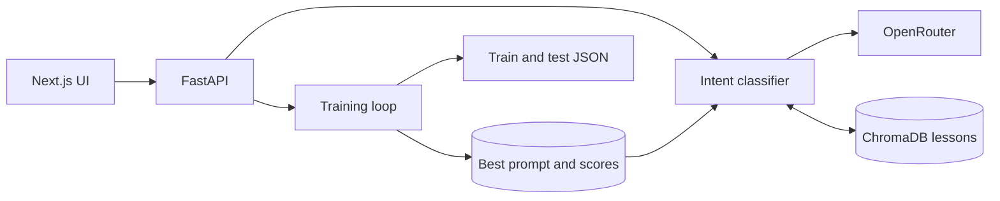

# Hawkeye Assistant

Hawkeye Assistant is a reconciliation intent classifier with a web chat interface. It classifies customer messages into operational intents and points users to the appropriate place in a reconciliation workflow.

The project does not fine-tune the language model. Instead, it can improve its behavior by:

- Rewriting and evaluating its classification prompt during batch training (an OPRO-style loop).
- Saving short lessons from mistakes in ChromaDB and retrieving relevant lessons during classification.
- Using user feedback in self-improving mode to reinforce lessons or add a new lesson.

The backend is a FastAPI service. The primary web UI is a Next.js app in `ui/`. An additional Streamlit UI is available at `src/hawkeye_assistant/ui/streamlit_app.py`.

## Intent labels

| Label | UI name | Guidance |
|---|---|---|
| `match_invoice` | Match invoice | Matching is not done in chat; use Workbench / Reconcile. |
| `unmatched_items` | Unmatched items | Open Reconcile and filter for unmatched or outstanding items. |
| `upload_document` | Upload document | Use the Ingestion Hub to import invoices or statements. |
| `amount_mismatch` | Amount mismatch | Review the amount gap in the Workbench; do not post a match. |
| `recon_status` | Recon status | Check progress and status filters in Reconcile. |
| `show_details` | Show details | Open the relevant ledger row, candidate pane, outstanding item, or match. |
| `audit_query` | Audit log | Check the audit log for who did what. |
| `other` | Other | Used for greetings, unclear, or unrelated requests. |

## How it works



- `data/train.json` is used to evaluate and improve prompts and lessons.
- `data/test.json` is held out for scoring. Test evaluation does not teach or update lessons.
- `data/demo.json` supplies sample messages for the Demo set page.
- `storage/memory_db/` contains the local ChromaDB lesson store.
- `storage/results.json` contains the best prompt, training log, and test scores.

Lessons are embedded with `BAAI/bge-small-en-v1.5` and stored using cosine
distance. Retrieval ignores matches farther than `0.45`, skips near-duplicate
examples below `0.08`, and reranks close matches with a small bonus for lessons
that have worked before. Lesson scores start at `0`, gain `1` for a correct
classification, lose `3` for an incorrect one, and are bounded from `0` to
`100`. The original message is indexed while the generated rule is stored with
the lesson metadata.

The embedding model and distance metric are part of the persisted ChromaDB
index. Back up or export any existing lessons before rebuilding
`storage/memory_db/` to use these settings.

The `storage/` files are generated locally and are not included in Git.

## Requirements

- Python **3.14 or newer**
- [uv](https://docs.astral.sh/uv/)
- Node.js and npm
- An [OpenRouter](https://openrouter.ai/) API key

## Setup

From the repository root, install the Python dependencies:

```bash
uv sync
```

Create a `.env` file in the repository root with your OpenRouter settings:

```env
OPENROUTER_API_KEY=your_key_here
OPENROUTER_MODEL=openai/gpt-4o-mini
# Optional; defaults to https://openrouter.ai/api/v1
# OPENROUTER_BASE_URL=https://openrouter.ai/api/v1
# Hawkeye connection (defaults to http://127.0.0.1:8003)
# HAWKEYE_BASE_URL=http://127.0.0.1:8003
# HAWKEYE_API_PREFIX=/api/v1
# Set true when serving over HTTPS in production.
# ASSISTANT_COOKIE_SECURE=false
```

Do not commit `.env` or share your API key. Settings are loaded when the backend starts, so restart the API after changing `.env`.

Install the web UI dependencies:

```bash
cd ui
npm install
```

## Run locally

Start the backend and web UI in separate terminals. Start the API first.

**Terminal 1 — FastAPI** (from the repository root):

```bash
uv run --python 3.14 uvicorn hawkeye_assistant.api.app:app --reload
```

The API is available at [http://127.0.0.1:8000](http://127.0.0.1:8000). Interactive API documentation is at [http://127.0.0.1:8000/docs](http://127.0.0.1:8000/docs).

In chat, request existing Hawkeye audit records (for example, “show user-created
audit logs for action MATCH_APPROVED since 2026-11-01”). The assistant requires a Hawkeye
Supervisor login and only reads audit records; it does not create or modify them.
It returns concise event summaries and includes detail fields only when the question
asks for them. Audit records are summarized locally and are not sent to the LLM.

**Terminal 2 — Next.js UI**:

```bash
cd ui
npm run dev
```

Open [http://localhost:3000](http://localhost:3000). By default, the Next.js app forwards `/api/*` requests to `http://127.0.0.1:8000`. To use another backend address, set `API_URL` before starting Next.js.

### Optional: Streamlit UI

The repository also includes the earlier Streamlit interface. With the API running, start it from the repository root:

```bash
uv run streamlit run src/hawkeye_assistant/ui/streamlit_app.py
```

Open the address printed by Streamlit (normally [http://localhost:8501](http://localhost:8501)).

## Using the web UI

- **Chat**: Submit a customer message to see its predicted intent and workflow guidance.
- **Normal mode**: Uses the default prompt and does not request lessons or feedback.
- **Self-improving mode**: Uses the best trained prompt and retrieved lessons when available, and lets you confirm or correct predictions.
- **Before vs After**: Compare a classification with the default prompt and without memory against the trained prompt and retrieved lessons.
- **Demo set**: Run the messages in `data/demo.json` through the classifier.
- **Training**: View training results and run training. Training makes LLM calls and can take time.

Training is optional. Before the first training run, classification can use the default prompt. To use the trained prompt, run training from the Training page or use the API below.

## Training

Run the default five-round training loop from the repository root:

```bash
uv run python -m hawkeye_assistant.training.train
```

Training evaluates examples in `data/train.json`, creates lessons from selected mistakes, updates lesson scores, and asks the LLM to rewrite the prompt. After training, the best prompt is evaluated against `data/test.json` and the results are saved to `storage/results.json`.

Training and classification call the configured OpenRouter model. These calls may incur API usage or charges. The number of rounds can also be set through the API.

## API

The service runs on port `8000` by default.

| Method | Path | Purpose |
|---|---|---|
| `POST` | `/classify` | Classify a message. Body: `{"text":"...", "use_memory":true, "use_best_prompt":true}`. The two flags default to `true`. |
| `POST` | `/feedback` | Submit a prediction and its correct intent. Body: `{"text":"...", "predicted":"...", "correct":"..."}`. |
| `POST` | `/train?rounds=5` | Run batch training. |
| `GET` | `/results` | Read saved training results; returns `404` before training has produced results. |
| `GET` | `/results?ensure_before=true` | Also score and save the default prompt's test score if it has not been calculated yet. |
| `GET` | `/lessons` | List lessons and their scores. |

Example classification request:

```bash
curl -X POST http://127.0.0.1:8000/classify \
  -H 'Content-Type: application/json' \
  -d '{"text":"Who matched this payment to the invoice?","use_memory":false,"use_best_prompt":false}'
```

## Development

Install development dependencies and run the Python checks from the repository root:

```bash
uv sync --group dev
uv run ruff check .
uv run pytest
```

Run the UI linter from `ui/`:

```bash
npm run lint
```

## Project structure

```text
hawkeye-assistant/
├── data/                         Training, test, and demo examples
├── src/hawkeye_assistant/
│   ├── agent/                     Intent classification
│   ├── api/                       FastAPI endpoints
│   ├── evaluation/                Prompt evaluation
│   ├── memory/                    ChromaDB lesson storage and search
│   ├── optimizer/                 Lesson generation and prompt rewriting
│   ├── training/                  Batch training loop
│   └── ui/                        Streamlit interface
├── storage/                       Local generated results and memory
├── tests/                         Python tests
└── ui/                             Next.js web application
```
